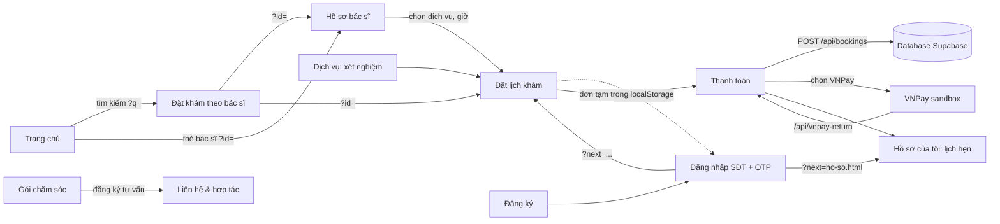
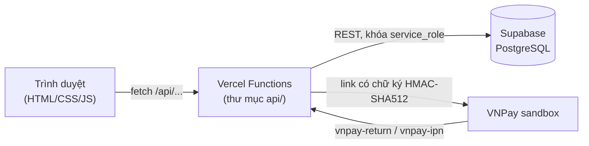

# HomeCare – Website chăm sóc sức khỏe tại nhà

> **Đồ án môn Internet và Công nghệ Web (IE104)**
> Trường Đại học Công nghệ Thông tin – ĐHQG TP.HCM · **Nhóm 13**

| | |
|---|---|
| **Đề tài** | Website đặt lịch chăm sóc sức khỏe tại nhà **HomeCare** |
| **Công nghệ** | Giao diện: HTML5 · CSS3 · JavaScript thuần (không framework, không thư viện JS) |
| **Backend** | Node.js thuần chạy dạng **Vercel Functions** (thư mục `api/`) · cơ sở dữ liệu **Supabase (PostgreSQL)** · cổng thanh toán **VNPay sandbox** |
| **Quy mô** | 14 trang HTML · 16 file CSS · 15 file JS giao diện · 5 API (có chú thích tiếng Việt) |
| **Thiết kế** | Dựng theo bản thiết kế Figma của nhóm, có responsive cho điện thoại và máy tính bảng |

---

## 1. Giới thiệu đề tài

**HomeCare** là nền tảng kết nối **khách hàng** với **bác sĩ, điều dưỡng** để chăm sóc sức khỏe ngay tại nhà: khách hàng tìm bác sĩ, xem hồ sơ và lịch làm việc, đặt lịch, thanh toán và theo dõi lịch hẹn; bác sĩ quản lý lịch hẹn và hồ sơ hành nghề của mình.

Đồ án tập trung vào **kỹ thuật xây dựng giao diện web thuần**:

- Chia nhỏ giao diện thành các trang HTML ngữ nghĩa, tái sử dụng CSS và JS dùng chung (header, footer, màu sắc, nút bấm).
- Xử lý nghiệp vụ hoàn toàn ở phía trình duyệt bằng JavaScript: tìm kiếm, lọc, sắp xếp, phân trang, kiểm tra form, tính tiền.
- Dữ liệu mẫu (bác sĩ, dịch vụ) nằm trong mảng đối tượng (array of objects); các trang trao đổi thông tin với nhau qua tham số trên đường dẫn (`?id=`, `?q=`…).
- **Có backend** (theo góp ý của giảng viên): đăng nhập bằng số điện thoại + mã OTP, **lịch khám lưu vào database** (Supabase/PostgreSQL), thanh toán thử qua **VNPay sandbox**. Chi tiết ở [mục 4](#4-backend-và-cơ-sở-dữ-liệu).

---

## 2. Các trang và chức năng

### 2.1. Danh sách trang

| # | Trang | File | Chức năng chính |
|:-:|---|---|---|
| 1 | Trang chủ | `index.html` | Banner, ô tìm kiếm có **gợi ý xổ xuống khi gõ** (bác sĩ, chuyên khoa, dịch vụ; chọn bằng chuột hoặc phím mũi tên), **bác sĩ tiêu biểu ngay dưới banner** – bấm "Xem tất cả" thì danh sách bác sĩ **trượt xuống ngay trong trang**, khối dịch vụ, đối tác |
| 2 | Đăng nhập | `dang-nhap.html` | Chọn vai trò Khách hàng / Bác sĩ; 2 cách đăng nhập: **số điện thoại + mã OTP** (gửi mã, đếm ngược gửi lại, kiểm tra mã trên máy chủ) hoặc mật khẩu (mô phỏng); đăng nhập xong quay lại đúng trang đang đứng (`?next=`) |
| 3 | Đăng ký khách hàng | `dang-ky-khach-hang.html` | Form 2 cột, kiểm tra email/SĐT bằng regex, kiểm tra từng ô khi rời ô nhập, tải file kéo thả |
| 4 | Đăng ký bác sĩ | `dang-ky-bac-si.html` | Giống trang 3, thêm "Loại chứng chỉ" và "Chuyên môn" |
| 5 | Đặt khám theo bác sĩ | `dat-kham.html` | 12 bác sĩ/điều dưỡng; tìm kiếm không dấu; tab Bác sĩ / Điều dưỡng; **lọc theo chuyên khoa**; sắp xếp theo lượt khám, giá; phân trang 4 người/trang (đã bỏ đánh giá sao) |
| 6 | Hồ sơ bác sĩ | `chi-tiet-bac-si.html` | Thông tin, giới thiệu, quá trình công tác, bảng giá dịch vụ, lịch làm việc 7 ngày tới, đánh giá |
| 7 | Đặt lịch khám | `dat-lich.html` | **Bắt buộc đăng nhập bằng SĐT + OTP**. Chọn gói dịch vụ, ngày, khung giờ trống (giờ đã có người đặt lấy từ database); **triệu chứng dạng danh sách xổ xuống có ô tích + mục "Khác" tự nhập**; SĐT liên hệ khác **không bắt buộc** (nhập thì phải đúng 10 hoặc 11 số); tóm tắt và tính tiền theo thời gian thực; lưu "đơn tạm" |
| 8 | Thanh toán & xác nhận | `thanh-toan.html` | Đọc "đơn tạm"; 4 phương thức (tiền mặt, chuyển khoản QR, ví MoMo, **cổng VNPay sandbox**); mã giảm giá; xác nhận → **lưu lịch hẹn vào database** (máy chủ sinh mã `HC123456`, tự tính lại tiền, chặn đặt trùng giờ); chọn VNPay thì chuyển sang trang thanh toán thử của VNPay rồi quay về xem kết quả |
| 9 | Dịch vụ | `dich-vu.html` | 4 nhóm dịch vụ; chọn xét nghiệm (8 loại), tự tính số lượng và tổng tiền, chuyển sang đặt lịch lấy mẫu |
| 10 | Gói chăm sóc | `goi-cham-soc.html` | 4 gói định kỳ, chuyển trả theo tháng/năm (năm giảm 15%), đăng ký tư vấn |
| 11 | Hướng dẫn & chính sách | `huong-dan.html` | Cách đặt lịch, 9 câu hỏi thường gặp (tìm kiếm, mở/thu gọn tất cả), hoàn tiền, điều khoản, bảo mật |
| 12 | Giới thiệu | `about.html` | Giới thiệu HomeCare, đối tác, nhóm thực hiện (trang tĩnh) |
| 13 | Liên hệ & hợp tác | `contact.html` | Form liên hệ/hợp tác, đếm ký tự, tự điền chủ đề từ đường dẫn, kiểm tra dữ liệu |
| 14 | Hồ sơ của tôi | `ho-so.html` | Một trang cho 2 vai trò. **Khách hàng**: xem/lọc/hủy lịch hẹn (lịch thật tải từ database), sửa thông tin. **Bác sĩ**: xác nhận/từ chối/hoàn thành lịch hẹn, sửa hồ sơ hành nghề, chọn ngày làm việc. Có đăng xuất |

> Trang **Tin tức** đã được bỏ theo góp ý của giảng viên.

### 2.2. Luồng sử dụng chính



### 2.3. Hướng dẫn trải nghiệm nhanh

1. Chạy `npm run dev`, mở http://localhost:3000. Gõ "nhi" hoặc "tim mach" vào ô tìm kiếm → danh sách gợi ý xổ xuống (gõ không dấu vẫn ra). Bấm **Xem tất cả** ở khối Bác sĩ tiêu biểu → danh sách trượt xuống.
2. Bấm **Đặt lịch** của một bác sĩ → trang báo phải đăng nhập → **Đăng nhập bằng số điện thoại**: nhập SĐT 10–11 số, bấm *Gửi mã OTP*, mã hiện trong hộp "Chế độ demo" → nhập mã → tự quay lại trang đặt lịch.
3. Chọn ngày giờ, tích vài triệu chứng (thử tích **Khác** để tự nhập), bỏ trống SĐT liên hệ khác (hoặc nhập sai 9 số để xem báo lỗi) → **Thanh toán**.
4. Thử mã giảm giá `HOMECARE10` / `GIAM50K`, chọn **Tiền mặt** rồi xác nhận → lịch hẹn được lưu vào database. Chọn **Cổng VNPay** (khi đã cấu hình) → thanh toán bằng thẻ test → quay về màn hình kết quả.
5. Mở **Hồ sơ của tôi** → thấy lịch vừa đặt, thử **Hủy lịch**. Quay lại trang đặt lịch cùng bác sĩ: khung giờ vừa đặt đã bị khóa.

---

## 3. Kỹ thuật web đã áp dụng

### HTML

| Kỹ thuật | Dùng ở |
|---|---|
| Form tự kiểm tra bằng JS (`novalidate`), ô tải file (`accept`), nhiều kiểu `<input>` (text, radio, checkbox, file) | Đăng nhập, đăng ký, đặt lịch, thanh toán, liên hệ |
| `<details>` / `<summary>` (câu hỏi xổ ra; danh sách triệu chứng có ô tích) | `huong-dan.html`, `dat-lich.html` |
| Thuộc tính `data-*` (`data-page`, `data-role`) | Mọi trang có header; `ho-so.html` |
| Thẻ giữ chỗ `#site-header`, `#site-footer` để JS chèn nội dung | Tất cả trang trừ Đăng nhập |
| Bảng `<table>` (bảng giá, so sánh gói, chính sách), thuộc tính `aria-*` | `chi-tiet-bac-si.html`, `goi-cham-soc.html`, `huong-dan.html`; menu di động |

### CSS

| Kỹ thuật | Dùng ở |
|---|---|
| Biến CSS `:root`, reset CSS | `base.css` (dùng cho cả 15 trang) |
| Flexbox và Grid (bố cục nhiều cột, lưới thẻ) | Hầu hết các file CSS |
| `position: sticky` (header dính đầu trang, cột bên dính khi cuộn) | `layout.css`, `dat-kham.css`, `dat-lich.css`, `chi-tiet-bac-si.css`, `ho-so.css`… (7 file) |
| Menu con khi rê chuột (`:hover`, `:focus-within`), hiệu ứng `transition` | `layout.css` |
| Selector nâng cao `:has()` (tô viền thẻ đang chọn, không cần JS) | `dang-ky.css`, `dat-lich.css`, `dich-vu.css`, `ho-so.css`, `thanh-toan.css` |
| `:focus-within`, `::before` / `::after` | `dang-nhap.css`, `huong-dan.css`, `layout.css`… |
| Responsive bằng `@media` (máy tính → máy tính bảng → điện thoại) | 16 file CSS |
| `@keyframes` (hiệu ứng chuyển động, VD: dấu tích "pop-in" khi đặt lịch thành công) | `thanh-toan.css`, `contact.css` |

### JavaScript

| Kỹ thuật | Dùng ở |
|---|---|
| Thao tác DOM: `querySelector(All)`, `classList.toggle`, `outerHTML`, `textContent` | `layout.js` và mọi file JS |
| Xử lý sự kiện: `submit`, `click`, `input`, `blur`, `change`, kéo thả, `preventDefault` | Các trang có form, tìm kiếm |
| Mảng đối tượng + vòng lặp + **template string** để sinh HTML | `dat-kham.js`, `goi-cham-soc.js`, `dich-vu.js`, `du-lieu.js` |
| `filter`, `sort`, `map` (lọc, sắp xếp, phân trang) | `dat-kham.js`, `ho-so.js` |
| **Tìm kiếm không dấu** (`normalize("NFD")` + regex) | `dat-kham.js`, `huong-dan.js` |
| **Biểu thức chính quy** kiểm tra email, số điện thoại | `dang-ky.js`, `contact.js` |
| `URLSearchParams` đọc tham số trên đường dẫn (`?id=`, `?q=`, `?next=`) | `dat-kham.js`, `chi-tiet-bac-si.js`, `dat-lich.js`, `contact.js`, `dang-nhap.js` |
| **`localStorage`** lưu tài khoản, đơn tạm, lịch hẹn; `JSON.stringify/parse`; `try…catch` khi bị chặn | `dang-nhap.js`, `du-lieu.js`, `dat-lich.js`, `ho-so.js`, `layout.js` |
| Kéo thả và kiểm tra file (loại, dung lượng) | `dang-ky.js` |
| Làm việc với ngày giờ (`Date`, tạo lịch 7 ngày, khung giờ) | `du-lieu.js`, `dat-lich.js`, `chi-tiet-bac-si.js` |
| Chống chèn mã HTML (`escapeHTML`) khi hiển thị chữ người dùng nhập | `du-lieu.js`, dùng ở `thanh-toan.js`, `ho-so.js`… |
| `encodeURIComponent` mã hóa từ khóa đưa lên đường dẫn | `home.js`, `api.js` |
| **`fetch` + `async/await`** gọi API máy chủ, xử lý lỗi theo mã HTTP (401, 409…) | `api.js`, `dang-nhap.js`, `dat-lich.js`, `thanh-toan.js`, `ho-so.js` |
| Gợi ý tìm kiếm xổ xuống, điều khiển bằng phím mũi tên, thuộc tính `aria-*` (combobox) | `home.js` |
| Hiệu ứng trượt bằng `grid-template-rows: 0fr → 1fr`, thuộc tính `inert` | `home.css`, `home.js` |

### Dữ liệu lưu trong `localStorage`

| Khóa | Nội dung | Ghi bởi |
|---|---|---|
| `homecare_user` | Tài khoản đang đăng nhập (tên, SĐT, vai trò, `verified: true` nếu đăng nhập bằng OTP) – chỉ để hiển thị; máy chủ xác thực bằng cookie `hc_session` | `dang-nhap.js` |
| `homecare_pending` | "Đơn tạm" đang chờ thanh toán | `dat-lich.js` (xóa sau khi xác nhận ở `thanh-toan.js`) |
| `homecare_appointments` | Bản sao lịch hẹn để hiển thị nhanh (lịch thật nằm trong database, `ho-so.js` tải lại mỗi lần mở trang) | `thanh-toan.js`, `ho-so.js` |
| `homecare_doctor_profile` | Hồ sơ hành nghề, lịch làm việc bác sĩ tự sửa | `ho-so.js` |
| `homecare_profile` | Thông tin cá nhân khách hàng (trang đặt lịch đọc để điền sẵn form) | `ho-so.js` |
| `homecare_doctor_appointments` | Lịch hẹn hiển thị ở phía bác sĩ (xác nhận / từ chối / hoàn thành) | `ho-so.js` |

---

## 4. Backend và cơ sở dữ liệu

> **AI prompt:** toàn bộ phần backend (thư mục `api/`, `database/`, `dev-server.js`, `js/api.js`) được viết với sự hỗ trợ của AI, theo góp ý của giảng viên. Xem thêm [mục 11](#11-ghi-chú-ai-prompt).

### 4.1. Kiến trúc



- Trình duyệt **không** kết nối thẳng database. Mọi thao tác đi qua API, API kiểm tra đăng nhập, kiểm tra dữ liệu, **tự tính lại tiền** (không tin số tiền trình duyệt gửi) rồi mới ghi vào database.
- Đăng nhập thành công → máy chủ đặt cookie `hc_session` (HttpOnly, có chữ ký HMAC, hạn 7 ngày).
- Không dùng thư viện npm nào: chỉ Node.js có sẵn (`crypto`, `fetch`, `http`).

### 4.2. Các API

| API | Chức năng |
|---|---|
| `POST /api/auth?action=send-otp` | Tạo mã OTP 6 số (hạn 5 phút, 60 giây mới gửi lại được). **Chế độ demo**: chưa gửi SMS thật, mã được trả về để hiện trên màn hình |
| `POST /api/auth?action=verify-otp` | Kiểm tra mã (sai tối đa 5 lần), tạo tài khoản nếu là lần đầu, đặt cookie đăng nhập |
| `GET /api/auth` · `POST /api/auth?action=logout` | Người đang đăng nhập + cấu hình máy chủ · Đăng xuất |
| `GET /api/bookings` | Lịch hẹn của tôi (bác sĩ: lịch bệnh nhân đặt với mình). `?code=` xem 1 lịch; `?doctorId=&slots=1` các khung giờ đã có người đặt |
| `POST /api/bookings` | Tạo lịch hẹn – **bắt buộc đăng nhập** |
| `PATCH /api/bookings` | Hủy / xác nhận / hoàn thành lịch hẹn (kiểm tra quyền theo vai trò) |
| `POST /api/payment` | Tạo link thanh toán VNPay cho 1 lịch hẹn |
| `GET /api/vnpay-return`, `GET /api/vnpay-ipn` | VNPay báo kết quả; máy chủ kiểm tra chữ ký và số tiền rồi cập nhật lịch hẹn |

### 4.3. Cơ sở dữ liệu (`database/schema.sql`)

| Bảng | Nội dung |
|---|---|
| `users` | Tài khoản: số điện thoại (duy nhất), vai trò, lần đăng nhập cuối |
| `otp_codes` | Mã OTP dạng **băm** (không lưu mã gốc), hạn dùng, số lần nhập sai |
| `bookings` | Lịch khám: mã lịch hẹn, người đặt, bác sĩ, dịch vụ, ngày giờ, người được khám, SĐT liên hệ khác, **triệu chứng** (JSON), địa chỉ, các khoản tiền, phương thức + trạng thái thanh toán, mã giao dịch VNPay, trạng thái lịch hẹn |

Ràng buộc `UNIQUE (doctor_id, booking_date, booking_time)` (trừ lịch đã hủy) giúp **không thể đặt trùng giờ** cùng một bác sĩ, kể cả khi 2 người bấm cùng lúc. Tất cả bảng bật Row Level Security, không mở quyền cho khóa công khai.

### 4.4. Cài đặt Supabase + Vercel (làm 1 lần)

1. Tạo project miễn phí tại [supabase.com](https://supabase.com) → **SQL Editor** → dán toàn bộ `database/schema.sql` → **Run**.
2. **Project Settings → API**: copy *Project URL* và khóa *service_role* (hoặc *secret key*). **Không** đưa khóa này vào code giao diện hay commit lên GitHub.
3. Trên Vercel: **Project → Settings → Environment Variables**, thêm các biến trong `.env.example`:
   - `SUPABASE_URL`, `SUPABASE_SERVICE_ROLE_KEY` (bắt buộc)
   - `VNP_TMN_CODE`, `VNP_HASH_SECRET` (nếu dùng VNPay)
   - `SESSION_SECRET` (không bắt buộc), `OTP_DEMO=true`
4. **Redeploy**. Vercel tự nhận thư mục `api/` thành các API, không cần cấu hình thêm.

### 4.5. VNPay sandbox

1. Đăng ký tài khoản thử nghiệm miễn phí tại https://sandbox.vnpayment.vn/devreg/ → VNPay gửi **TMN Code** và **Hash Secret** qua email.
2. Điền vào `VNP_TMN_CODE`, `VNP_HASH_SECRET` (file `.env` khi chạy máy, hoặc biến môi trường Vercel).
3. Thanh toán thử bằng thẻ test: ngân hàng **NCB**, số thẻ `9704198526191432198`, tên `NGUYEN VAN A`, ngày phát hành `07/15`, OTP `123456` (đối chiếu lại với email VNPay gửi).
4. (Tùy chọn) Khai báo IPN URL `https://<ten-mien>/api/vnpay-ipn` trên trang quản trị sandbox.

Chưa cấu hình VNPay thì lựa chọn VNPay ở trang thanh toán tự bị khóa, các phương thức khác vẫn dùng bình thường.

---

## 5. Cấu trúc thư mục

```
homecare/
├── index.html                 Trang chủ
├── dang-nhap.html             Đăng nhập
├── dang-ky-khach-hang.html    Đăng ký khách hàng
├── dang-ky-bac-si.html        Đăng ký bác sĩ
├── dat-kham.html              Đặt khám theo bác sĩ
├── chi-tiet-bac-si.html       Hồ sơ bác sĩ
├── dat-lich.html              Đặt lịch khám
├── thanh-toan.html            Thanh toán & xác nhận
├── dich-vu.html               Dịch vụ
├── goi-cham-soc.html          Gói chăm sóc
├── huong-dan.html             Hướng dẫn & chính sách
├── about.html                 Giới thiệu
├── contact.html               Liên hệ & hợp tác
├── ho-so.html                 Hồ sơ của tôi (khách hàng / bác sĩ)
├── css/
│   ├── base.css               Biến màu, reset, nút bấm, class dùng chung
│   ├── layout.css             Header, menu, footer (dùng chung)
│   ├── trang-con.css          Khung và thành phần chung của các trang con
│   ├── home.css, dang-nhap.css, dang-ky.css, dat-kham.css
│   └── chi-tiet-bac-si.css, dat-lich.css, thanh-toan.css, dich-vu.css,
│       goi-cham-soc.css, huong-dan.css, about.css,
│       contact.css, ho-so.css
├── js/
│   ├── layout.js              Chèn header/footer, tô sáng menu, menu di động (dùng chung)
│   ├── du-lieu.js             Dữ liệu bác sĩ + hàm dùng chung cho luồng đặt lịch
│   ├── api.js                 Gọi API máy chủ (fetch), dùng ở các trang cần đăng nhập/đặt lịch
│   ├── home.js, dang-nhap.js, dang-ky.js, dat-kham.js
│   └── chi-tiet-bac-si.js, dat-lich.js, thanh-toan.js, dich-vu.js,
│       goi-cham-soc.js, huong-dan.js, contact.js, ho-so.js
├── images/
│   ├── hero-bac-si.png        Ảnh banner trang chủ
│   └── doi-tac/               Logo đối tác
├── api/                       BACKEND (Vercel Functions, Node.js thuần)
│   ├── auth.js                Đăng nhập SĐT + OTP, đăng xuất
│   ├── bookings.js            Lưu / đọc / hủy lịch khám
│   ├── payment.js             Tạo link thanh toán VNPay
│   ├── vnpay-return.js        VNPay chuyển người dùng về
│   ├── vnpay-ipn.js           VNPay gọi ngầm báo kết quả
│   └── _lib/                  Code dùng chung (không phải API): http, db, auth, catalog, vnpay
├── database/schema.sql        Tạo bảng trên Supabase
├── dev-server.js              Chạy web + API trên máy (npm run dev)
├── package.json               Lệnh npm run dev (không có thư viện phụ thuộc)
└── .env.example               Mẫu biến môi trường (copy thành .env)
```

**Nguyên tắc tổ chức:** mỗi trang có một file CSS và một file JS riêng, cùng dùng `base.css` + `layout.css` + `layout.js`. Các trang con dùng thêm `trang-con.css`. Các trang thuộc luồng đặt lịch dùng thêm `du-lieu.js` (nạp **trước** file JS riêng).

---

## 6. Phân công

Mỗi người **chỉ sửa file của mình**, vì vậy khi commit sẽ không bao giờ bị conflict. Đầu mỗi file đều có dòng `Người phụ trách: THÀNH VIÊN X`.

| Thành viên | MSSV | Họ và tên | Phần | File phụ trách | Kiến thức chính |
|:---:|:---:|---|---|---|---|
| **TV1** | 24521785 | Hồ Đình Tín | Phần chung | `README.md`, `css/base.css`, `css/layout.css`, `js/layout.js` | Biến CSS `:root`, reset CSS, header `sticky`, menu con khi rê chuột, `@media`; JS chèn HTML bằng `outerHTML`, `classList.toggle` |
| **TV2** | 24521714 | Châu Phước Thọ | Trang chủ và các trang con | `index.html`, `about.html`, `contact.html`, `dich-vu.html`, `goi-cham-soc.html`, `huong-dan.html`, `chi-tiet-bac-si.html`, `dat-lich.html`, `thanh-toan.html`, `ho-so.html`; CSS và JS tương ứng (`home`, `trang-con`, `about`, `contact`, `dich-vu`, `goi-cham-soc`, `huong-dan`, `chi-tiet-bac-si`, `dat-lich`, `thanh-toan`, `ho-so`, `du-lieu`); thư mục `images/` | Flexbox, Grid, margin âm, hiệu ứng `hover`; JS bắt sự kiện `submit`, `preventDefault`, chuyển trang kèm tham số `?q=`; `URLSearchParams`, `localStorage`, `<details>`, tính tiền, tìm kiếm không dấu |
| **TV3** | 24521746 | Trần Minh Thuận | Đăng nhập | `dang-nhap.html`, `css/dang-nhap.css`, `js/dang-nhap.js` | Bố cục 2 cột, `::before` / `::after`, `:focus-within`; JS chọn vai trò, hiện/ẩn mật khẩu, kiểm tra form |
| **TV4** | 24521842 | Phạm Minh Trí | Đăng ký (2 trang) | `dang-ky-khach-hang.html`, `dang-ky-bac-si.html`, `css/dang-ky.css`, `js/dang-ky.js` | Form 2 cột bằng Grid, `:has()`; JS kiểm tra email/SĐT bằng regex, sự kiện `blur` / `change`, kéo thả file |
| **TV5** | 24521848 | Lê Nguyễn Minh Triết | Đặt khám | `dat-kham.html`, `css/dat-kham.css`, `js/dat-kham.js` | Grid + cột `sticky`; JS mảng object, template string, tìm kiếm không dấu, sắp xếp, phân trang, `URLSearchParams` |

---

## 7. Phần dùng chung (TV1) – quy ước cho cả nhóm

### 7.1. Thứ tự nhúng file

Trong `<head>`: file chung trước, file riêng sau (để CSS riêng ghi đè được CSS chung). Cuối `<body>`: `layout.js` trước, file JS riêng sau.

```html
<link rel="stylesheet" href="css/base.css">      <!-- 1. biến, reset, nút bấm -->
<link rel="stylesheet" href="css/layout.css">    <!-- 2. header, footer (trừ trang đăng nhập) -->
<link rel="stylesheet" href="css/ten-trang.css"> <!-- 3. riêng của trang -->
...
<script src="js/layout.js"></script>
<script src="js/ten-trang.js"></script>
```

### 7.2. Biến CSS (`css/base.css`)

Không gõ thẳng mã màu vào CSS riêng, hãy dùng `var(--ten-bien)`. Muốn đổi màu cả website chỉ cần sửa trong `:root`.

| Biến | Giá trị | Dùng cho |
|---|---|---|
| `--primary` | `#1ba075` | Xanh chính: nút, icon, viền khi focus |
| `--primary-dark` | `#0f6e56` | Xanh đậm: tiêu đề, chữ nhấn, nút khi hover |
| `--primary-darker` | `#0f7c5c` | Xanh rất đậm: đầu form đăng ký, nền footer |
| `--primary-light` | `#e1f5ee` | Xanh nhạt: nền banner, nền huy hiệu |
| `--white`, `--bg-light`, `--border` | `#ffffff`, `#f5f9f7`, `#e5e7eb` | Nền thẻ, nền khu vực nhạt, màu viền |
| `--text`, `--text-light` | `#1f2937`, `#6b7280` | Chữ thường, chữ phụ |
| `--error`, `--star` | `#dc2626`, `#f59e0b` | Báo lỗi form, ngôi sao đánh giá |
| `--accent`, `--accent-light` | `#e9962b`, `#fdf1e0` | Cam vàng phụ: viền dưới header, hotline, huy hiệu |
| `--radius`, `--radius-lg` | `10px`, `16px` | Bo góc nhỏ (ô nhập, nút), bo góc lớn (thẻ) |
| `--shadow`, `--font` | | Đổ bóng thẻ, font Be Vietnam Pro |

### 7.3. Class dùng chung (`css/base.css`)

| Class | Công dụng |
|---|---|
| `.container` | Khung nội dung rộng tối đa 1200px, tự căn giữa |
| `.btn` + `.btn-primary` / `.btn-outline` | Nút nền xanh / nút viền xanh |
| `.btn-small`, `.btn-block`, `.btn-pill` | Nút nhỏ / rộng hết dòng / bo tròn 2 đầu |
| `.avatar`, `.rating` | Ảnh đại diện chữ cái đầu / dòng đánh giá sao |
| `.badge`, `.badge-green` | Huy hiệu nhỏ màu cam / xanh |

Ví dụ: `<a href="dat-kham.html" class="btn btn-outline btn-small">Đặt lịch</a>`

### 7.4. Header, footer và menu (`js/layout.js`)

Header/footer **không viết trong HTML của từng trang**. Mỗi trang chỉ đặt thẻ giữ chỗ, `layout.js` thay thế bằng nội dung thật (bằng `outerHTML`):

| Thẻ giữ chỗ | Được thay bằng | Dùng ở |
|---|---|---|
| `<div id="site-header"></div>` | Topbar + header + menu | Các trang có menu |
| `<div id="site-footer"></div>` | Footer đầy đủ 4 cột | Các trang có menu |
| `<div id="site-footer-simple"></div>` | Footer rút gọn | 2 trang đăng ký |

Trang Đăng nhập theo thiết kế **không có** header/footer. Nút "Tài khoản" ở topbar tự đổi thành tên người dùng sau khi đăng nhập. Menu dùng mảng `menuItems` ở đầu `layout.js`, muốn thêm hoặc sửa mục chỉ cần sửa mảng này.

**Tô sáng mục menu bằng `data-page`** trên thẻ `<body>`:

| `data-page` | Mục được tô sáng |
|---|---|
| `dat-kham` (cũng áp dụng cho `dich-vu`) | Dịch vụ |
| `bac-si` | Bác sĩ |
| `goi-cham-soc` | Gói chăm sóc |
| `huong-dan` | Hướng dẫn |
| `lien-he` | Liên hệ hợp tác |
| `home`, `ho-so` hoặc không ghi | Không mục nào (theo Figma, menu không có "Trang chủ", bấm logo để về trang chủ) |

Trên điện thoại (≤ 1100px), nút ☰ dùng `classList.toggle("open")` để đóng/mở menu.

### 7.5. Lưu ý khi viết JS

Các file JS của một trang chạy chung một phạm vi, nên **không khai báo `const` / `let` trùng tên** giữa các file được nạp cùng trang (VD: `du-lieu.js` đã có `doctorData`, `formatMoney`…). `layout.js` được bọc trong một hàm tự chạy (IIFE) nên không ảnh hưởng đến các file khác.

---

## 8. Hướng dẫn chạy

Cần cài **Node.js 20.12 trở lên** (không cần `npm install`, dự án không có thư viện phụ thuộc).

```bash
git clone https://github.com/anhdangtutien/IE104---HOMECARE-SERVICE.git
cd IE104---HOMECARE-SERVICE
npm run dev          # mở http://localhost:3000
```

1. **Chạy thử ngay, không cần tài khoản gì**: chưa có file `.env` thì dữ liệu lưu tạm vào `.data/homecare-db.json`, OTP ở chế độ demo, VNPay bị khóa.
2. **Dùng Supabase / VNPay trên máy**: copy `.env.example` thành `.env`, điền khóa (xem mục 4.4, 4.5), chạy lại `npm run dev`.
3. **Live Server vẫn mở được giao diện**, nhưng không có API nên đăng nhập OTP, đặt lịch, thanh toán sẽ báo "Không tìm thấy máy chủ API". Hãy dùng `npm run dev` hoặc bản deploy Vercel.
4. Cần có **Internet** để tải font *Be Vietnam Pro* (Google Fonts) và icon *Font Awesome* (CDN).

---

## 9. Làm việc nhóm với Git

```bash
git pull                                   # luôn lấy code mới nhất trước khi làm
git add .
git commit -m "TV1: viet header sticky"    # ghi rõ ai làm, làm gì
git push
```

- Chỉ sửa **file của mình** (xem bảng phân công).
- Cần thêm biến màu hoặc class dùng chung → nhờ **TV1** thêm vào `base.css`, đừng tự sửa.
- Commit thường xuyên, mỗi lần một việc nhỏ.
- **Không commit file `.env`** (đã có trong `.gitignore`) vì chứa khóa bí mật.

---

## 10. Hạn chế và hướng phát triển

**Hạn chế hiện tại:**

- Dữ liệu bác sĩ, gói chăm sóc là **dữ liệu mẫu** viết sẵn trong mảng JavaScript (bảng giá phía máy chủ chép lại trong `api/_lib/catalog.js`, sửa giá phải sửa cả 2 nơi).
- OTP ở **chế độ demo**: mã hiện trên màn hình thay vì gửi SMS (muốn gửi thật cần thuê dịch vụ SMS như eSMS, Twilio – chỗ gắn đã ghi chú trong `api/auth.js`).
- Đăng nhập bằng mật khẩu vẫn là mô phỏng; mọi tài khoản bác sĩ được xem như cùng một bác sĩ mẫu (id = 1). Chọn vai trò "Bác sĩ" khi đăng nhập OTP chưa có bước duyệt.
- Thanh toán chỉ chạy trên **môi trường thử nghiệm** VNPay; chuyển khoản, MoMo vẫn mô phỏng.
- Phần sửa hồ sơ, lịch làm việc của bác sĩ vẫn lưu `localStorage`.

**Hướng phát triển:** gửi SMS OTP thật, tài khoản bác sĩ riêng có duyệt hồ sơ, đưa danh sách bác sĩ vào database, thông báo nhắc lịch qua email/SMS, bổ sung đánh giá thật từ khách hàng.

---

## 11. Ghi chú AI prompt

Theo yêu cầu của giảng viên, **mọi chỗ có dùng AI đều được ghi rõ chữ `AI prompt`** ngay tại chỗ đó (chú thích trong HTML/CSS/JS), kèm nội dung yêu cầu đã đưa cho AI. Tìm nhanh tất cả các chỗ:

```bash
grep -rn "AI prompt" --include=*.html --include=*.css --include=*.js --include=*.sql .
```

Các phần làm với sự hỗ trợ của AI (theo góp ý của giảng viên):

| Góp ý | File |
|---|---|
| Gợi ý tìm kiếm xổ xuống; bác sĩ tiêu biểu lên dưới banner, danh sách trượt xuống; sửa ngắt dòng tiêu đề banner | `index.html`, `css/home.css`, `js/home.js` |
| Lọc theo chuyên khoa, bỏ đánh giá sao | `dat-kham.html`, `css/dat-kham.css`, `js/dat-kham.js` |
| Triệu chứng dạng danh sách có ô tích + "Khác"; SĐT không bắt buộc (10–11 số); bắt buộc đăng nhập | `dat-lich.html`, `css/dat-lich.css`, `js/dat-lich.js` |
| Đăng nhập bằng số điện thoại + OTP | `dang-nhap.html`, `css/dang-nhap.css`, `js/dang-nhap.js`, `api/auth.js` |
| Bỏ trang Tin tức | `js/layout.js` |
| Database lưu lịch khám, thanh toán VNPay sandbox | `api/`, `database/schema.sql`, `dev-server.js`, `js/api.js`, `js/thanh-toan.js`, `js/ho-so.js`, `css/thanh-toan.css` |

---

<p align="center"><i>HomeCare – Đồ án môn Internet và Công nghệ Web (IE104) · Nhóm 13 · Trường ĐH Công nghệ Thông tin – ĐHQG TP.HCM</i></p>
