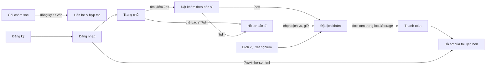

# HomeCare – Website chăm sóc sức khỏe tại nhà

> **Đồ án môn Internet và Công nghệ Web (IE104)**
> Trường Đại học Công nghệ Thông tin – ĐHQG TP.HCM · **Nhóm 13**

| | |
|---|---|
| **Đề tài** | Website đặt lịch chăm sóc sức khỏe tại nhà **HomeCare** |
| **Công nghệ** | HTML5 · CSS3 · JavaScript thuần (không framework, không thư viện JS) |
| **Quy mô** | 15 trang HTML · 17 file CSS · 15 file JS (khoảng 13.000 dòng, có chú thích tiếng Việt) |
| **Thiết kế** | Dựng theo bản thiết kế Figma của nhóm, có responsive cho điện thoại và máy tính bảng |

---

## 1. Giới thiệu đề tài

**HomeCare** là nền tảng kết nối **khách hàng** với **bác sĩ, điều dưỡng** để chăm sóc sức khỏe ngay tại nhà: khách hàng tìm bác sĩ, xem hồ sơ và lịch làm việc, đặt lịch, thanh toán và theo dõi lịch hẹn; bác sĩ quản lý lịch hẹn và hồ sơ hành nghề của mình.

Đồ án tập trung vào **kỹ thuật xây dựng giao diện web thuần**:

- Chia nhỏ giao diện thành các trang HTML ngữ nghĩa, tái sử dụng CSS và JS dùng chung (header, footer, màu sắc, nút bấm).
- Xử lý nghiệp vụ hoàn toàn ở phía trình duyệt bằng JavaScript: tìm kiếm, lọc, sắp xếp, phân trang, kiểm tra form, tính tiền.
- Mô phỏng một hệ thống thật khi **chưa có máy chủ**: dữ liệu mẫu nằm trong mảng đối tượng (array of objects), dữ liệu người dùng (tài khoản, lịch hẹn) lưu bằng `localStorage`, các trang trao đổi thông tin với nhau qua tham số trên đường dẫn (`?id=`, `?q=`…).

---

## 2. Các trang và chức năng

### 2.1. Danh sách trang

| # | Trang | File | Chức năng chính |
|:-:|---|---|---|
| 1 | Trang chủ | `index.html` | Banner, ô tìm kiếm bác sĩ/dịch vụ, 4 dịch vụ nổi bật, bác sĩ tiêu biểu, đối tác. Tìm kiếm (báo lỗi nếu bỏ trống) chuyển sang trang Đặt khám kèm `?q=`; nút "Đặt lịch" ở thẻ bác sĩ mở đúng hồ sơ bác sĩ đó (`?id=`) |
| 2 | Đăng nhập | `dang-nhap.html` | Chọn vai trò Khách hàng / Bác sĩ, hiện/ẩn mật khẩu, kiểm tra dữ liệu, lưu phiên đăng nhập |
| 3 | Đăng ký khách hàng | `dang-ky-khach-hang.html` | Form 2 cột, kiểm tra email/SĐT bằng regex, kiểm tra từng ô khi rời ô nhập, tải file kéo thả |
| 4 | Đăng ký bác sĩ | `dang-ky-bac-si.html` | Giống trang 3, thêm "Loại chứng chỉ" và "Chuyên môn" |
| 5 | Đặt khám theo bác sĩ | `dat-kham.html` | 12 bác sĩ/điều dưỡng; tìm kiếm không dấu; tab Bác sĩ / Điều dưỡng; sắp xếp theo đánh giá, giá; phân trang 4 người/trang |
| 6 | Hồ sơ bác sĩ | `chi-tiet-bac-si.html?id=` | Thông tin, giới thiệu, quá trình công tác, bảng giá dịch vụ, lịch làm việc 7 ngày tới, đánh giá |
| 7 | Đặt lịch khám | `dat-lich.html?id=` | Chọn gói dịch vụ, ngày, khung giờ trống; tóm tắt và tính tiền theo thời gian thực; lưu "đơn tạm" |
| 8 | Thanh toán & xác nhận | `thanh-toan.html` | Đọc "đơn tạm" từ trang đặt lịch; 4 phương thức thanh toán (tiền mặt, chuyển khoản QR, ví MoMo, thẻ), mỗi loại hiện hướng dẫn riêng; mã giảm giá; tự tính lại tổng tiền; xác nhận → sinh mã lịch hẹn (dạng `HC123456`), lưu vào danh sách lịch hẹn và hiện màn hình thành công. Vào thẳng trang khi chưa chọn lịch thì được dẫn về Đặt khám |
| 9 | Dịch vụ | `dich-vu.html` | 4 nhóm dịch vụ; chọn xét nghiệm (8 loại), tự tính số lượng và tổng tiền, chuyển sang đặt lịch lấy mẫu |
| 10 | Gói chăm sóc | `goi-cham-soc.html` | 4 gói định kỳ, chuyển trả theo tháng/năm (năm giảm 15%), đăng ký tư vấn |
| 11 | Tin tức & cẩm nang | `tin-tuc.html` | 8 bài viết, lọc theo chuyên mục, tìm kiếm không dấu, đọc bài trong hộp thoại `<dialog>`, đăng ký bản tin |
| 12 | Hướng dẫn & chính sách | `huong-dan.html` | Cách đặt lịch, 9 câu hỏi thường gặp (tìm kiếm, mở/thu gọn tất cả), hoàn tiền, điều khoản, bảo mật |
| 13 | Giới thiệu | `about.html` | Giới thiệu HomeCare, đối tác, nhóm thực hiện (trang tĩnh) |
| 14 | Liên hệ & hợp tác | `contact.html` | Form liên hệ/hợp tác, đếm ký tự, tự điền chủ đề từ đường dẫn, kiểm tra dữ liệu |
| 15 | Hồ sơ của tôi | `ho-so.html` | Một trang cho 2 vai trò. **Khách hàng**: xem/lọc/hủy lịch hẹn, sửa thông tin. **Bác sĩ**: xác nhận/từ chối/hoàn thành lịch hẹn, sửa hồ sơ hành nghề, chọn ngày làm việc. Có đăng xuất |

### 2.2. Luồng sử dụng chính



### 2.3. Hướng dẫn trải nghiệm nhanh (dành cho người chấm)

1. Mở `index.html`, gõ tên hoặc chuyên khoa vào ô tìm kiếm → chuyển sang **Đặt khám** với từ khóa đã điền sẵn (gõ không dấu vẫn tìm được).
2. Bấm **Xem hồ sơ** của một bác sĩ → chọn khung giờ trống trong lịch 7 ngày → sang **Đặt lịch**, điền thông tin.
3. Sang **Thanh toán**, thử đổi phương thức (chọn MoMo giảm thêm 5%, tối đa 20.000đ) và mã giảm giá `HOMECARE10` (giảm 10% phí dịch vụ, tối đa 50.000đ) hoặc `GIAM50K` (giảm 50.000đ cho đơn từ 300.000đ), tích đồng ý điều khoản rồi xác nhận để xem màn hình thành công.
4. Vào **Đăng nhập** (tên đăng nhập bất kỳ, mật khẩu từ 6 ký tự), thử cả hai vai trò **Khách hàng** và **Bác sĩ** → mở **Hồ sơ của tôi** để thấy giao diện thay đổi theo vai trò.

---

## 3. Kỹ thuật web đã áp dụng

### HTML

| Kỹ thuật | Dùng ở |
|---|---|
| Form tự kiểm tra bằng JS (`novalidate`), ô tải file (`accept`), nhiều kiểu `<input>` (text, radio, checkbox, file) | Đăng nhập, đăng ký, đặt lịch, thanh toán, liên hệ |
| `<details>` / `<summary>` (câu hỏi xổ ra, không cần JS) | `huong-dan.html` |
| `<dialog>` (hộp thoại đọc bài) | `tin-tuc.html` |
| Thuộc tính `data-*` (`data-page`, `data-role`) | Mọi trang có header; `ho-so.html` |
| Thẻ giữ chỗ `#site-header`, `#site-footer` để JS chèn nội dung | Tất cả trang trừ Đăng nhập |
| Bảng `<table>` (bảng giá, so sánh gói, chính sách), thuộc tính `aria-*` | `chi-tiet-bac-si.html`, `goi-cham-soc.html`, `huong-dan.html`; menu di động |

### CSS

| Kỹ thuật | Dùng ở |
|---|---|
| Biến CSS `:root`, reset CSS | `base.css` (dùng cho cả 15 trang) |
| Flexbox và Grid (bố cục nhiều cột, lưới thẻ) | Hầu hết các file CSS |
| `position: sticky` (header dính đầu trang, cột bên dính khi cuộn) | `layout.css`, `dat-kham.css`, `dat-lich.css`, `chi-tiet-bac-si.css`, `ho-so.css`… (7 file) |
| Menu con khi rê chuột (`:hover`, `:focus-within`), hiệu ứng `transition` | `layout.css` |
| Selector nâng cao `:has()` (tô viền thẻ đang chọn, không cần JS) | `dang-ky.css`, `dat-lich.css`, `dich-vu.css`, `ho-so.css`, `thanh-toan.css` |
| `:focus-within`, `::before` / `::after` | `dang-nhap.css`, `huong-dan.css`, `layout.css`… |
| Responsive bằng `@media` (máy tính → máy tính bảng → điện thoại) | 16 file CSS |
| `@keyframes` (hiệu ứng chuyển động, VD: dấu tích "pop-in" khi đặt lịch thành công) | `thanh-toan.css`, `contact.css` |

### JavaScript

| Kỹ thuật | Dùng ở |
|---|---|
| Thao tác DOM: `querySelector(All)`, `classList.toggle`, `outerHTML`, `textContent` | `layout.js` và mọi file JS |
| Xử lý sự kiện: `submit`, `click`, `input`, `blur`, `change`, kéo thả, `preventDefault` | Các trang có form, tìm kiếm |
| Mảng đối tượng + vòng lặp + **template string** để sinh HTML | `dat-kham.js`, `goi-cham-soc.js`, `tin-tuc.js`, `dich-vu.js`, `du-lieu.js` |
| `filter`, `sort`, `map` (lọc, sắp xếp, phân trang) | `dat-kham.js`, `tin-tuc.js`, `ho-so.js` |
| **Tìm kiếm không dấu** (`normalize("NFD")` + regex) | `dat-kham.js`, `tin-tuc.js`, `huong-dan.js` |
| **Biểu thức chính quy** kiểm tra email, số điện thoại | `dang-ky.js`, `contact.js` |
| `URLSearchParams` đọc tham số trên đường dẫn (`?id=`, `?q=`, `?loai=`, `?next=`) | `dat-kham.js`, `chi-tiet-bac-si.js`, `dat-lich.js`, `tin-tuc.js`, `contact.js`, `dang-nhap.js` |
| **`localStorage`** lưu tài khoản, đơn tạm, lịch hẹn; `JSON.stringify/parse`; `try…catch` khi bị chặn | `dang-nhap.js`, `du-lieu.js`, `dat-lich.js`, `ho-so.js`, `layout.js` |
| Kéo thả và kiểm tra file (loại, dung lượng) | `dang-ky.js` |
| Làm việc với ngày giờ (`Date`, tạo lịch 7 ngày, khung giờ) | `du-lieu.js`, `dat-lich.js`, `chi-tiet-bac-si.js` |
| Chống chèn mã HTML (`escapeHTML`) khi hiển thị chữ người dùng nhập | `du-lieu.js`, dùng ở `thanh-toan.js`, `ho-so.js`… |
| `setTimeout` giả lập thời gian máy chủ xử lý; `encodeURIComponent` mã hóa từ khóa đưa lên đường dẫn | `thanh-toan.js`, `home.js` |

### Dữ liệu lưu trong `localStorage`

| Khóa | Nội dung | Ghi bởi |
|---|---|---|
| `homecare_user` | Tài khoản đang đăng nhập (tên, vai trò) | `dang-nhap.js` |
| `homecare_pending` | "Đơn tạm" đang chờ thanh toán | `dat-lich.js` (xóa sau khi xác nhận ở `thanh-toan.js`) |
| `homecare_appointments` | Danh sách lịch hẹn đã đặt | `thanh-toan.js`, `ho-so.js` |
| `homecare_doctor_profile` | Hồ sơ hành nghề, lịch làm việc bác sĩ tự sửa | `ho-so.js` |
| `homecare_profile` | Thông tin cá nhân khách hàng (trang đặt lịch đọc để điền sẵn form) | `ho-so.js` |
| `homecare_doctor_appointments` | Lịch hẹn hiển thị ở phía bác sĩ (xác nhận / từ chối / hoàn thành) | `ho-so.js` |

---

## 4. Cấu trúc thư mục

```
homecare/
├── index.html                 Trang chủ
├── dang-nhap.html             Đăng nhập
├── dang-ky-khach-hang.html    Đăng ký khách hàng
├── dang-ky-bac-si.html        Đăng ký bác sĩ
├── dat-kham.html              Đặt khám theo bác sĩ
├── chi-tiet-bac-si.html       Hồ sơ bác sĩ
├── dat-lich.html              Đặt lịch khám
├── thanh-toan.html            Thanh toán & xác nhận
├── dich-vu.html               Dịch vụ
├── goi-cham-soc.html          Gói chăm sóc
├── tin-tuc.html               Tin tức & cẩm nang
├── huong-dan.html             Hướng dẫn & chính sách
├── about.html                 Giới thiệu
├── contact.html               Liên hệ & hợp tác
├── ho-so.html                 Hồ sơ của tôi (khách hàng / bác sĩ)
├── css/
│   ├── base.css               Biến màu, reset, nút bấm, class dùng chung
│   ├── layout.css             Header, menu, footer (dùng chung)
│   ├── trang-con.css          Khung và thành phần chung của các trang con
│   ├── home.css, dang-nhap.css, dang-ky.css, dat-kham.css
│   └── chi-tiet-bac-si.css, dat-lich.css, thanh-toan.css, dich-vu.css,
│       goi-cham-soc.css, tin-tuc.css, huong-dan.css, about.css,
│       contact.css, ho-so.css
├── js/
│   ├── layout.js              Chèn header/footer, tô sáng menu, menu di động (dùng chung)
│   ├── du-lieu.js             Dữ liệu bác sĩ + hàm dùng chung cho luồng đặt lịch
│   ├── home.js, dang-nhap.js, dang-ky.js, dat-kham.js
│   └── chi-tiet-bac-si.js, dat-lich.js, thanh-toan.js, dich-vu.js,
│       goi-cham-soc.js, tin-tuc.js, huong-dan.js, contact.js, ho-so.js
└── images/
    ├── hero-bac-si.png        Ảnh banner trang chủ
    └── doi-tac/               Logo đối tác
```

**Nguyên tắc tổ chức:** mỗi trang có một file CSS và một file JS riêng, cùng dùng `base.css` + `layout.css` + `layout.js`. Các trang con dùng thêm `trang-con.css`. Các trang thuộc luồng đặt lịch dùng thêm `du-lieu.js` (nạp **trước** file JS riêng).

---

## 5. Phân công

Mỗi người **chỉ sửa file của mình**, vì vậy khi commit sẽ không bao giờ bị conflict. Đầu mỗi file đều có dòng `Người phụ trách: THÀNH VIÊN X`.

| Thành viên | MSSV | Họ và tên | Phần | File phụ trách | Kiến thức chính (để thuyết trình) |
|:---:|:---:|---|---|---|---|
| **TV1** | 24521785 | Hồ Đình Tín | Phần chung | `README.md`, `css/base.css`, `css/layout.css`, `js/layout.js` | Biến CSS `:root`, reset CSS, header `sticky`, menu con khi rê chuột, `@media`; JS chèn HTML bằng `outerHTML`, `classList.toggle` |
| **TV2** | 24521714 | Châu Phước Thọ | Trang chủ và các trang con | `index.html`, `about.html`, `contact.html`, `dich-vu.html`, `goi-cham-soc.html`, `tin-tuc.html`, `huong-dan.html`, `chi-tiet-bac-si.html`, `dat-lich.html`, `thanh-toan.html`, `ho-so.html`; CSS và JS tương ứng (`home`, `trang-con`, `about`, `contact`, `dich-vu`, `goi-cham-soc`, `tin-tuc`, `huong-dan`, `chi-tiet-bac-si`, `dat-lich`, `thanh-toan`, `ho-so`, `du-lieu`); thư mục `images/` | Flexbox, Grid, margin âm, hiệu ứng `hover`; JS bắt sự kiện `submit`, `preventDefault`, chuyển trang kèm tham số `?q=`; `URLSearchParams`, `localStorage`, `<dialog>`, `<details>`, tính tiền, tìm kiếm không dấu |
| **TV3** | 24521746 | Trần Minh Thuận | Đăng nhập | `dang-nhap.html`, `css/dang-nhap.css`, `js/dang-nhap.js` | Bố cục 2 cột, `::before` / `::after`, `:focus-within`; JS chọn vai trò, hiện/ẩn mật khẩu, kiểm tra form |
| **TV4** | 24521842 | Phạm Minh Trí | Đăng ký (2 trang) | `dang-ky-khach-hang.html`, `dang-ky-bac-si.html`, `css/dang-ky.css`, `js/dang-ky.js` | Form 2 cột bằng Grid, `:has()`; JS kiểm tra email/SĐT bằng regex, sự kiện `blur` / `change`, kéo thả file |
| **TV5** | 24521848 | Lê Nguyễn Minh Triết | Đặt khám | `dat-kham.html`, `css/dat-kham.css`, `js/dat-kham.js` | Grid + cột `sticky`; JS mảng object, template string, tìm kiếm không dấu, sắp xếp, phân trang, `URLSearchParams` |

---

## 6. Phần dùng chung (TV1) – quy ước cho cả nhóm

### 6.1. Thứ tự nhúng file

Trong `<head>`: file chung trước, file riêng sau (để CSS riêng ghi đè được CSS chung). Cuối `<body>`: `layout.js` trước, file JS riêng sau.

```html
<link rel="stylesheet" href="css/base.css">      <!-- 1. biến, reset, nút bấm -->
<link rel="stylesheet" href="css/layout.css">    <!-- 2. header, footer (trừ trang đăng nhập) -->
<link rel="stylesheet" href="css/ten-trang.css"> <!-- 3. riêng của trang -->
...
<script src="js/layout.js"></script>
<script src="js/ten-trang.js"></script>
```

### 6.2. Biến CSS (`css/base.css`)

Không gõ thẳng mã màu vào CSS riêng, hãy dùng `var(--ten-bien)`. Muốn đổi màu cả website chỉ cần sửa trong `:root`.

| Biến | Giá trị | Dùng cho |
|---|---|---|
| `--primary` | `#1ba075` | Xanh chính: nút, icon, viền khi focus |
| `--primary-dark` | `#0f6e56` | Xanh đậm: tiêu đề, chữ nhấn, nút khi hover |
| `--primary-darker` | `#0f7c5c` | Xanh rất đậm: đầu form đăng ký, nền footer |
| `--primary-light` | `#e1f5ee` | Xanh nhạt: nền banner, nền huy hiệu |
| `--white`, `--bg-light`, `--border` | `#ffffff`, `#f5f9f7`, `#e5e7eb` | Nền thẻ, nền khu vực nhạt, màu viền |
| `--text`, `--text-light` | `#1f2937`, `#6b7280` | Chữ thường, chữ phụ |
| `--error`, `--star` | `#dc2626`, `#f59e0b` | Báo lỗi form, ngôi sao đánh giá |
| `--accent`, `--accent-light` | `#e9962b`, `#fdf1e0` | Cam vàng phụ: viền dưới header, hotline, huy hiệu |
| `--radius`, `--radius-lg` | `10px`, `16px` | Bo góc nhỏ (ô nhập, nút), bo góc lớn (thẻ) |
| `--shadow`, `--font` | | Đổ bóng thẻ, font Be Vietnam Pro |

### 6.3. Class dùng chung (`css/base.css`)

| Class | Công dụng |
|---|---|
| `.container` | Khung nội dung rộng tối đa 1200px, tự căn giữa |
| `.btn` + `.btn-primary` / `.btn-outline` | Nút nền xanh / nút viền xanh |
| `.btn-small`, `.btn-block`, `.btn-pill` | Nút nhỏ / rộng hết dòng / bo tròn 2 đầu |
| `.avatar`, `.rating` | Ảnh đại diện chữ cái đầu / dòng đánh giá sao |
| `.badge`, `.badge-green` | Huy hiệu nhỏ màu cam / xanh |

Ví dụ: `<a href="dat-kham.html" class="btn btn-outline btn-small">Đặt lịch</a>`

### 6.4. Header, footer và menu (`js/layout.js`)

Header/footer **không viết trong HTML của từng trang**. Mỗi trang chỉ đặt thẻ giữ chỗ, `layout.js` thay thế bằng nội dung thật (bằng `outerHTML`):

| Thẻ giữ chỗ | Được thay bằng | Dùng ở |
|---|---|---|
| `<div id="site-header"></div>` | Topbar + header + menu | Các trang có menu |
| `<div id="site-footer"></div>` | Footer đầy đủ 4 cột | Các trang có menu |
| `<div id="site-footer-simple"></div>` | Footer rút gọn | 2 trang đăng ký |

Trang Đăng nhập theo thiết kế **không có** header/footer. Nút "Tài khoản" ở topbar tự đổi thành tên người dùng sau khi đăng nhập. Menu dùng mảng `menuItems` ở đầu `layout.js`, muốn thêm hoặc sửa mục chỉ cần sửa mảng này.

**Tô sáng mục menu bằng `data-page`** trên thẻ `<body>`:

| `data-page` | Mục được tô sáng |
|---|---|
| `dat-kham` (cũng áp dụng cho `dich-vu`) | Dịch vụ |
| `bac-si` | Bác sĩ |
| `goi-cham-soc` | Gói chăm sóc |
| `tin-tuc` | Tin tức |
| `huong-dan` | Hướng dẫn |
| `lien-he` | Liên hệ hợp tác |
| `home`, `ho-so` hoặc không ghi | Không mục nào (theo Figma, menu không có "Trang chủ", bấm logo để về trang chủ) |

Trên điện thoại (≤ 1100px), nút ☰ dùng `classList.toggle("open")` để đóng/mở menu.

### 6.5. Lưu ý khi viết JS

Các file JS của một trang chạy chung một phạm vi, nên **không khai báo `const` / `let` trùng tên** giữa các file được nạp cùng trang (VD: `du-lieu.js` đã có `doctorData`, `formatMoney`…). `layout.js` được bọc trong một hàm tự chạy (IIFE) nên không ảnh hưởng đến các file khác.

---

## 7. Hướng dẫn chạy

Không cần cài đặt hay build gì thêm.

```bash
git clone https://github.com/anhdangtutien/IE104---HOMECARE-SERVICE.git
cd IE104---HOMECARE-SERVICE
```

1. Mở thư mục bằng **VS Code**, cài tiện ích **Live Server**, bấm chuột phải vào `index.html` → **Open with Live Server**. (Hoặc mở thẳng `index.html` bằng trình duyệt.)
2. Cần có **Internet** để tải font *Be Vietnam Pro* (Google Fonts) và icon *Font Awesome* (CDN).
3. Dữ liệu đăng nhập và lịch hẹn lưu trong `localStorage` của trình duyệt. Muốn làm lại từ đầu: mở DevTools → Application → Local Storage → Clear.

---

## 8. Làm việc nhóm với Git

```bash
git pull                                   # luôn lấy code mới nhất trước khi làm
git add .
git commit -m "TV1: viet header sticky"    # ghi rõ ai làm, làm gì
git push
```

- Chỉ sửa **file của mình** (xem bảng phân công).
- Cần thêm biến màu hoặc class dùng chung → nhờ **TV1** thêm vào `base.css`, đừng tự sửa.
- Commit thường xuyên, mỗi lần một việc nhỏ.

---

## 9. Hạn chế và hướng phát triển

**Hạn chế hiện tại** (do đồ án chạy hoàn toàn trên trình duyệt, chưa có máy chủ):

- Dữ liệu bác sĩ, gói chăm sóc, bài viết là **dữ liệu mẫu** viết sẵn trong mảng JavaScript.
- Đăng nhập chỉ **mô phỏng** (lưu vai trò và tên vào `localStorage`), chưa có xác thực thật; mọi tài khoản bác sĩ được xem như cùng một bác sĩ mẫu.
- Thanh toán và gửi form liên hệ mang tính mô phỏng, chưa kết nối cổng thanh toán hay email.
- Một số liên kết/nút phụ (đăng nhập Facebook, Zalo, OTP…) hiện thông báo "đang phát triển".

**Hướng phát triển:** xây dựng máy chủ và cơ sở dữ liệu (Node.js + cơ sở dữ liệu) để thay `localStorage`, xác thực người dùng thật, tích hợp cổng thanh toán, thông báo nhắc lịch qua email/SMS, bổ sung đánh giá thật từ khách hàng.

---

<p align="center"><i>HomeCare – Đồ án môn Internet và Công nghệ Web (IE104) · Nhóm 13 · Trường ĐH Công nghệ Thông tin – ĐHQG TP.HCM</i></p>
